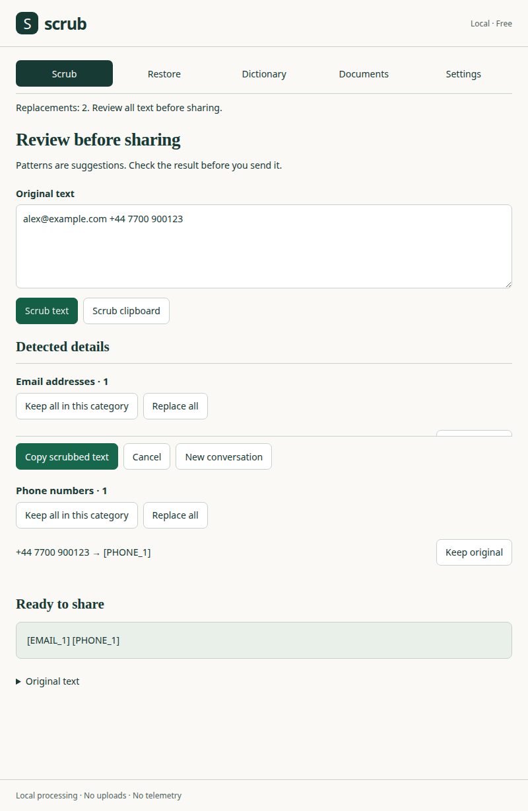

# Scrub Desktop

Scrub replaces private details with reversible placeholders before you paste text into an AI chat. Copy the answer and restore the original details locally, or use the same engine from your terminal.



## Use it

Copy text, press **Ctrl+Alt+S** (macOS **Control+Option+S**), review each replacement, then choose **Copy scrubbed text**. Paste it into your chat yourself. Copy the answer and press **Ctrl+Alt+R** to restore it. Unknown placeholders remain unchanged and are listed in the Restore view.

Use **New conversation** to start a fresh mapping. Otherwise later scrubs reuse the current conversation’s placeholders. The tray menu and Restore view keep the latest ten conversations, labelled only by time and item count. Shortcuts and optional automatic copying are configurable in Settings.

Dictionary terms and aliases use the same CSV format as the Scrub extension. Documents accepts DOCX, TXT, CSV and Markdown, lets you review replacements, and saves a separate copy. Export a mapping JSON if you need to restore that document later; treat it as sensitive because it contains the original values.

## Install or build

- **macOS:** `brew install onurkat/scrub/scrub-desktop` (built from source on your Mac, see below).
- **Linux:** AppImage and .deb on the [releases page](https://github.com/onurkat/scrub-desktop/releases/latest).
- **Windows:** [Microsoft Store](https://apps.microsoft.com/detail/9PJ0NKMT45S4) or build from source.
- **CLI:** `brew install onurkat/scrub/scrub`.

### From source

Use Node 20 or newer and stable Rust. Linux also needs WebKitGTK 4.1 development files, a C/C++ toolchain, Ayatana AppIndicator development files, librsvg and patchelf. On Windows, install the Microsoft C++ build tools and WebView2; on macOS, the Xcode command-line tools.

```sh
npm ci
npm test
cargo test --manifest-path src-tauri/Cargo.toml
cargo clippy --manifest-path src-tauri/Cargo.toml --all-targets -- -D warnings
npx tauri build
```

Linux defaults to `.deb` and AppImage bundles in `src-tauri/target/release/bundle/`. For macOS use `npx tauri build --bundles app`; for Windows use `npx tauri build --no-bundle`, then `powershell -File packaging/msstore/build.ps1` with the Windows SDK installed. Windows Store identity reservation is documented in `packaging/msstore/listing.md`.

### macOS / Homebrew

The [onurkat/homebrew-scrub](https://github.com/onurkat/homebrew-scrub) tap builds the tagged source archive on your Mac, so the app opens without a Gatekeeper prompt:

```sh
brew install onurkat/scrub/scrub-desktop
brew install onurkat/scrub/scrub
ln -s "$(brew --prefix scrub-desktop)/Scrub.app" /Applications/Scrub.app
```

The app runs in the menu bar without a Dock icon. It does not synthesize keystrokes or require Accessibility permission. **Start at login** is opt-in. CI tests the formulas against a local source archive before release; they do not download prebuilt apps or change downloaded-code security attributes.

### Windows

Install Scrub from the [Microsoft Store](https://apps.microsoft.com/detail/9PJ0NKMT45S4). The unsigned MSIX built here is for Store submission, not a signed public installer. CI creates a separate temporary self-signed copy solely to test installation and the packaged executable. Scrub stays in the notification area; click its icon to open the window.

### Linux

Install the built `.deb` with your package manager, or make the built AppImage executable and launch it. On systems without FUSE, run it with `APPIMAGE_EXTRACT_AND_RUN=1`. The tray requires the desktop’s status-notifier/AppIndicator support. A Flathub manifest preparation is in `packaging/flathub/`; it is not submitted.

On X11, Scrub registers global shortcuts directly. On Wayland, add custom keyboard shortcuts in GNOME/KDE for:

```sh
scrub-desktop --scrub-clipboard
scrub-desktop --restore-clipboard
scrub-desktop --open
```

These commands forward to the existing process; text never goes in command arguments. The window briefly takes focus before reading the Wayland clipboard, including when Skip review is enabled. It uses GTK’s focused selection API rather than relying on a privileged compositor data-control protocol. Nested Weston coverage is recorded in QA.md.

## CLI

Install the local npm package without publishing:

```sh
npm pack
npm install --global ./onurkat-scrub-1.0.3.tgz
```

Scrub a prompt before passing it to a terminal agent (the final `claude` command, not Scrub, sends the scrubbed text):

```sh
printf 'Contact alex@example.com' | scrub --mapping conversation.json | claude -p
```

Scrub a log, with counts on stderr and exit code 3 when something was detected:

```sh
scrub server.log --dictionary dictionary.csv --mapping log-mapping.json --report --fail-on-detect > safe.log
```

Restore an answer:

```sh
scrub restore answer.txt --mapping conversation.json > restored.txt
```

`--continue conversation.json` reuses a mapping. `--policy policy.json` passes detector/dictionary options to the shared engine. `--json` emits structured output. DOCX requires `--out output.docx`, including for restoration. Text defaults to stdin/stdout; `-` explicitly selects stdin. Exit codes are 0 success, 1 usage, 2 input/output error, and 3 detection with `--fail-on-detect`.

DOCX warnings are printed to stderr in the system language (or `--language tr`, for example), using categories and counts without original values. Inspect the document before sharing. Re-run with `--save-anyway` to write a DOCX with uninspected content; without it, neither output nor mapping is saved. The desktop Documents tab presents the same warnings and requires **Save anyway**.

`--keep` explicitly saves a mapping in the desktop’s shared store; `scrub restore --last` uses it. Without `--keep`, the CLI writes only output/mapping files you explicitly request.

## Privacy and local data

There are no runtime API calls, uploads, telemetry, accounts, updates or licence checks. About links open only after a click in your system browser/mail client; the app webview rejects external navigation. The clipboard is read only for an action you invoke.

Mappings are held in memory by default. **Keep mappings on this device** writes originals to `mappings.json`, atomically with mode 0600 on Unix. Turning it off deletes that file. **Clear all mappings** removes saved and session mappings after confirmation. Dictionary entries and settings are intentionally saved locally independently of mapping retention.

Application data is stored at:

- Linux: `$XDG_DATA_HOME/com.onurkat.scrub-desktop` (default `~/.local/share/com.onurkat.scrub-desktop`)
- macOS: `~/Library/Application Support/com.onurkat.scrub-desktop`
- Windows: `%APPDATA%\com.onurkat.scrub-desktop`

`SCRUB_DATA_DIR` overrides this for isolated tests or a portable profile. Delete this directory with Scrub closed to reset all settings and saved dictionaries too. Saved mapping files are plaintext; storage permissions are not encryption.

`--self-test` tests the engine and clipboard, restores the previous text clipboard, then exits 0/1. If it cannot safely read the previous text, it fails without replacing it. On X11 without a clipboard manager, a small internal owner process retains the restored clipboard after exit and ends when the clipboard changes; it receives text through stdin, never argv or files.

## Development

`npm run sync-engine` refreshes the six canonical engine files from a sibling Scrub checkout (or `SCRUB_SOURCE`). Tests verify the recorded hashes and compare directly against the source when present. `tools/prepare-ui.js` creates browser assets and resolves the bundled fflate import without changing canonical engine files.

`QA.md` maps each acceptance requirement to executable checks and evidence. Browser tests use an explicit test-only Tauri bridge; native tests exercise the actual Linux executable. Set `CHROME_BIN` when Chromium is not in the standard Playwright cache.

GPL-3.0-or-later. Source: https://github.com/onurkat/scrub-desktop · Support: onur@okteknoloji.com · Sponsors: https://github.com/sponsors/onurkat

### Prompt guards for Claude Code and Gemini CLI

With the `scrub` CLI installed on PATH (Node 20+), run these commands in your
project directory. The default scope is the current directory, not a search for
the nearest Git root:

```sh
scrub hook install claude-code --project
scrub hook install gemini --project
# Or install for all projects in your user settings:
scrub hook install claude-code --user
scrub hook install gemini --user
```

The installers merge `.claude/settings.json` / `.gemini/settings.json` (or the
same paths under your home directory), preserving other hooks and settings.
Restart the host CLI and confirm the hook is enabled/trusted. Existing host
settings that disable hooks are preserved. Repeated installation is idempotent.
Use `scrub hook uninstall claude-code [--project|--user]` or
`scrub hook uninstall gemini [--project|--user]` in the same scope to remove only
Scrub's command handler.

[Claude Code UserPromptSubmit](https://code.claude.com/docs/en/hooks#userpromptsubmit)
and [Gemini BeforeAgent](https://geminicli.com/docs/hooks/reference/#beforeagent)
pass JSON containing `prompt` to `scrub hook run claude-code` / `scrub hook run
gemini`. Scrub checks the engine's default detectors plus the desktop shared
store's dictionary and aliases, even when desktop detector switches are off.
A detection exits 2 and prints category counts to stderr, without original
values. Scrub with Ctrl+Alt+S or the `scrub` command and resubmit; an explicit
`#noscrub` prefix followed by whitespace (or end of prompt) bypasses the check.
Clean prompts exit 0 with no output. Invalid input, an unreadable dictionary or
input over 8 MiB blocks with a generic error. No prompt or mapping is saved by
Scrub's guard. Host CLI history/storage remains governed by the host; this guard
checks submitted text, not attachments, tool results or every model request.
